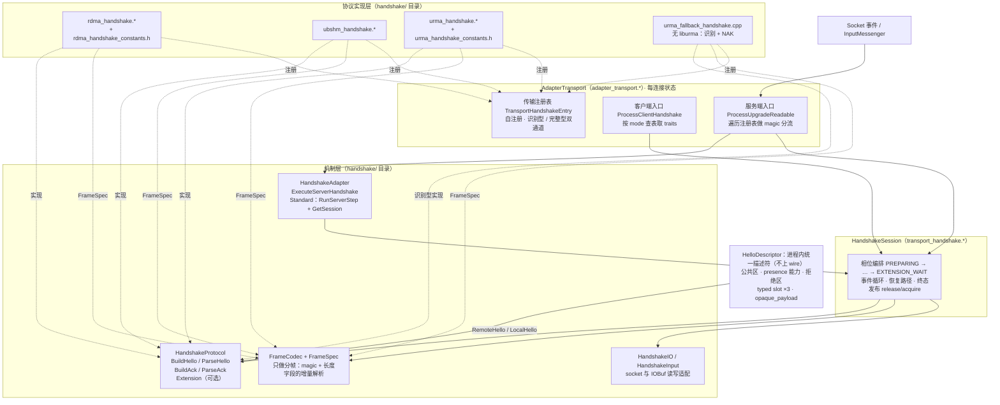
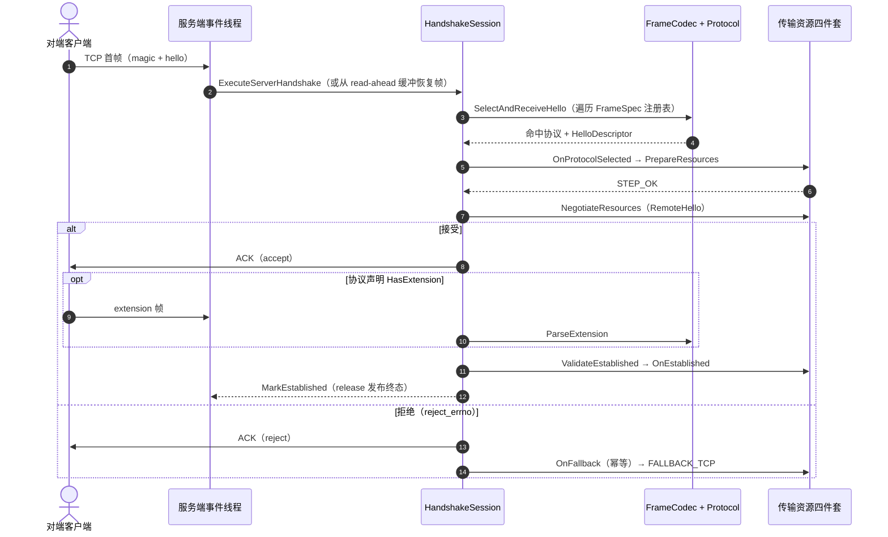

# 公共传输握手机制设计（RDMA / UBSHM / URMA）

本文档描述以 master 为基线、将 RDMA、UBSHM、URMA 三套独立握手收敛为一套
公共握手机制的设计。模块与接口命名沿用 `urma-handshake` 分支的参考实现
（本文所有接口签名、枚举取值均已与该分支源码逐条核对）；握手信息描述
机制借鉴 Mooncake transfer-engine 的 `HandShakeDesc` 模式。

- [背景与现状](#背景与现状)
- [设计目标与非目标](#设计目标与非目标)
- [设计原则：Mooncake 的可借鉴点与不可移植边界](#设计原则mooncake-的可借鉴点与不可移植边界)
- [总体架构](#总体架构)
- [握手信息描述机制：HelloDescriptor](#握手信息描述机制hellodescriptor)
- [帧层与 wire 格式](#帧层与-wire-格式)
- [会话状态机](#会话状态机)
- [线程模型与内存序](#线程模型与内存序)
- [兼容性设计](#兼容性设计)
- [正确性约束清单](#正确性约束清单)
- [冗余削减设计](#冗余削减设计)
- [扩展性与可维护性设计](#扩展性与可维护性设计)
- [分阶段落地计划](#分阶段落地计划)
- [测试策略](#测试策略)
- [风险与权衡](#风险与权衡)

## 背景与现状

master 上三个传输各自实现了一套私有的"TCP 连接建立后原地升级为高速传输"
握手，互不共享代码：

| 传输 | 握手代码位置（master） | 规模 |
|---|---|---|
| RDMA | `src/brpc/rdma/rdma_handshake.{h,cpp}` + `rdma_handshake_server.{h,cpp}` + `rdma_handshake.proto` + `rdma_handshake_constants.h` + `policy/rdma_handshake_protocol.{h,cpp}` | ~1230 行独立文件，另有 ~41 处握手调用点散布在 `rdma_endpoint.cpp` |
| UBSHM | 内联于 `src/brpc/ubshm/ub_endpoint.cpp`（36 处握手相关代码） | endpoint 共 ~1060 行，握手约占一半 |
| URMA | `src/brpc/urma/urma_handshake.{h,cpp}`（~540 行）+ 状态机内联于 `urma_endpoint.cpp`（42 处握手相关代码） | endpoint 共 ~1850 行 |

三套实现重复着同一组模式，但各有漂移：

1. **magic 前缀分流**：服务端窥看连接首字节（`"RDMA"/"RDM3"`、`"UB"`、
   `"URMA"/"URM3"`），识别为自身协议则进入升级流程，否则回退 TCP。
2. **hello/ack 报文交换**：客户端发 hello，服务端回 ACK/NAK；RDMA 与 URMA
   均有 v2（二进制定长）与 v3（protobuf）两个 wire 版本。
3. **状态机**：hello → ack →（可选）extension → established / fallback，
   三份状态机同构但各自实现。
4. **回退 TCP**：任一步骤失败，连接必须退化为普通 TCP 连接继续服务，
   不能断开。
5. **握手数据被 `InputMessenger` 读走后的恢复**：server 端协议解析器
   （`ParseHandshakeMessage`）需要从 socket 的 read-ahead 缓冲中取回
   handshake 字节。

重复的代价已经显现：同类 bug 需要修三遍（例如 handshake 数据残留导致
首包误解析的问题在 RDMA/URMA/UBSHM 上分别修过）；新增传输需要复制整套
脚手架（约 800 行）；行为细节在三套实现间漂移（如 ACK 校验严格程度、
errno 选择、日志风格）。

## 设计目标与非目标

目标：

1. **共享会话编排**：连接升级的状态机、事件驱动、恢复路径、终态发布
   只实现一次（`HandshakeSession`）。
2. **共享帧编解码**：magic/长度字段的增量解析、长短校验、IOBuf 拼装
   只实现一次（`FrameCodec`），协议只声明帧规格（`FrameSpec`）。
3. **统一握手信息描述**：三个协议的握手内容在进程内用同一个描述符
   表达（`HelloDescriptor`，借鉴 Mooncake `HandShakeDesc`），传输层
   只消费一种数据结构。
4. **参与者表驱动**：每传输只提供"准备资源 / 应用对端 hello / 激活 /
   停用"四个操作与若干常量表，新增传输成本降到 ~300 行。
5. **保持 TCP 回退语义**：任一环节失败，连接原地退化为 TCP。

非目标（明确不做）：

- **不统一 wire 格式**。RDMA v2/v3、UBSHM v3、URMA v2/v3 的线上格式
  一个字节都不变；本设计统一的是进程内的数据结构与流程，不是报文。
- **不引入带外握手通道**（Mooncake 的独立 TCP JSON-RPC 模式不适用，
  见下节）。
- **不改变对外行为契约**：注册名 `transport_handshake`、gflags 名、
  bvar 命名、旧 peer 互通性全部保持。

## 设计原则：Mooncake 的可借鉴点与不可移植边界

Mooncake transfer-engine 的握手机制（`mooncake-transfer-engine`）：

- **带外通道**：`SocketHandShakePlugin` 在独立 TCP 连接上跑
  length-prefixed JSON RPC，与数据面完全分离；
- **单一描述符**：`HandShakeDesc`（`include/transfer_metadata.h:197`）
  是一个 33 行的超集结构体，公共字段 + `#ifdef` 门控的传输字段 +
  一个不透明 `payload`；
- **presence 即能力**：`ready_ack` 等可选字段以"字段是否出现"表达
  能力协商；
- **结构化拒绝**：`reply_msg` 非空即拒绝，拒绝永远以带内结构化回复
  返回，而不是传输层错误；
- **每传输成本极小**：每传输只填自己的 desc 切片 + 被动回调 + apply
  对端 desc（UB ~50 行、URMA ~330 行、EFA ~250 行）。

**可借鉴（本设计吸收）**：

1. 单一超集描述符作为 codec 与传输之间的唯一货币 → `HelloDescriptor`；
2. presence 即能力 → 可选字段 + `has_xxx` 标记；
3. 结构化拒绝 → `reject_errno`/`reject_msg`；
4. 每传输只剩"填描述符 / 应用描述符 / 资源操作四件套"。

**不可移植（本质差异，不做）**：

1. **带外通道不可移植**。brpc 必须在同一条 TCP 连接上带内升级：连接
   身份（fd、四元组、已缓冲的 read-ahead 数据）要保留，TCP 回退必须
   发生在原连接上。这决定了 brpc 需要 magic 分流、增量解析、终态发布
   等 Mooncake 没有的复杂度——这部分是本质复杂度，不是冗余。
2. **单一 JSON 报文不可移植**。brpc 必须兼容已部署的旧 peer 的二进制
   格式，报文层无法统一；统一只能发生在进程内描述符层。
3. **失败即拒绝不可移植**。Mooncake 握手失败即 `resetConnection`；
   brpc 的 TCP 回退是对外承诺的特性。

## 总体架构

组件分层视图（自上而下为调用方向；实线 = 调用/消费，虚线 = 实现/注册）：



一次服务端升级的主流程时序（客户端 `RunClient` 为其镜像：`SendHello` →
`ReceiveAck` → 可选 extension → `OnEstablished` → `MarkEstablished`）：



模块/文件命名沿用 `urma-handshake` 分支：

| 文件 | 职责 |
|---|---|
| `src/brpc/transport_handshake.h/.cpp` | `HandshakeSession`/`HandshakeProtocol`/`HandshakeTransport`：状态机、事件循环、恢复路径、终态发布 |
| `src/brpc/handshake/handshake_frame.h/.cpp` | `FrameSpec`/`FrameCodec`/`FrameResult`：增量帧解析 |
| `src/brpc/handshake/handshake_io.h/.cpp` | `HandshakeIO`/`HandshakeInput`：socket 与 IOBuf 的读写适配 |
| `src/brpc/handshake/handshake_adapter.h/.cpp` | `HandshakeAdapter`：升级协议与 `InputMessenger` 之间的最小接缝 |
| `src/brpc/adapter_transport.h/.cpp` | 每连接状态、客户端/服务端通用参与者、magic 分流 |
| `src/brpc/policy/transport_handshake_protocol.h/.cpp` | server 端协议壳；在 `global.cpp` 以 `CONNECTION_TYPE_ALL`、注册名 `transport_handshake` 注册 |
| `src/brpc/handshake/{rdma,ubshm,urma}_handshake.*` | 每协议的 codec、常量、协议对象 |
| `src/brpc/handshake/urma_fallback_handshake.cpp` | 无 liburma 环境下的 URMA hello 识别与 NAK 编解码 |

关键接口（与 `urma-handshake` 分支源码逐条核对）。 AdapterTransport 与各
传输之间的全部映射关系收敛到一张**传输注册表**（自注册、公共代码零
编辑），详见[扩展性与可维护性设计](#扩展性与可维护性设计)：

```cpp
// transport_handshake.h —— 每协议报文编解码。实现持有解析后的协议状态,
// 并通过 const ParsedHello& remote() const 暴露(见 HelloDescriptor 节)
class HandshakeProtocol {
public:
    virtual int ProtocolVersion() const = 0;
    virtual StepResult BuildHello(bool enabled, std::string* payload) = 0;
    virtual StepResult ParseHello(const std::string& payload) = 0;
    // RDMA 与 UBSHM 共用 4 字节网络序 ACK 的默认实现; ACK 格式不同可覆盖
    virtual StepResult BuildAck(bool enabled, std::string* payload);
    virtual StepResult ParseAck(const std::string& payload, bool* enabled);
    // 是否对"对端未启用本传输"的 hello 回 ACK(URMA legacy 为 false:
    // 不回 ACK 直接回退)
    virtual bool AckDisabledHello() const { return true; }
    virtual bool HasExtension() const { return false; }  // 可选 extension 帧
    virtual StepResult BuildExtension(bool, std::string*);
    virtual StepResult ParseExtension(const std::string&);
};

// transport_handshake.h —— 每传输的资源操作(参与者的委托目标)
class HandshakeTransport {
public:
    virtual void OnProtocolSelected(HandshakeProtocol*) {}  // 恢复路径须补调(C1)
    virtual StepResult PrepareResources() = 0;    // QP/jetty/shm 池准备
    virtual StepResult NegotiateResources() = 0;  // 应用对端 hello(读 protocol->remote())
    virtual void OnEstablished() = 0;             // 激活数据面
    virtual void OnFallback() = 0;                // 幂等; 释放资源(C3)
    virtual void OnFailed() = 0;
    virtual StepResult ValidateEstablished() { return STEP_OK; }  // ACK 后复查(C2)
};
// 另提供 FallbackHandshakeTransport / FallbackHandshakeProtocol 两个
// "只负责识别 hello 并回退"的便捷基类。

// handshake_adapter.h —— 升级协议与 InputMessenger 之间的最小接缝
class HandshakeAdapter {          // 每个 server Socket 一个
public:
    virtual ParseResult ExecuteServerHandshake(butil::IOBuf* source,
                                               Socket* socket) = 0;
};
class StandardHandshakeAdapter : public HandshakeAdapter {
    // 子类只提供 RunServerStep(source, socket) 与 GetSession(socket);
    // 公共会话持有全部相位。
};

// transport_handshake.h —— 相位编排、帧收发与终态发布
class HandshakeSession {
public:
    StepResult RunClient(HandshakeProtocol* protocol,
                         HandshakeTransport* transport);
    StepResult RunServer(const std::vector<HandshakeProtocol*>& protocols,
                         HandshakeInput* input,
                         HandshakeTransport* transport,
                         bool fallback_on_not_mine);
    int phase(butil::memory_order order) const;   // 跨线程观察唯一入口
    void MarkEstablished();                       // release 发布终态
    void MarkFailed();
    template <typename PublishTcpActive>
    void PublishFallback(PublishTcpActive publish_tcp_active);  // 见内存序节
    void SetIOForTest(HandshakeIO* io);           // 单测注入内存流
};
```

## 握手信息描述机制：HelloDescriptor

这是本设计从 Mooncake 吸收的核心机制。

### 问题

参考实现中，每个协议类持有解析结果并以 `const ParsedHello& remote()
const` 暴露，而 `ParsedHello` 是每协议各自的类型：

| 协议 | 解析后类型 | 定义处 |
|---|---|---|
| RDMA | `RdmaConnectionInfo`（block_size / sq_size / rq_size / lid / gid / qp_num / `optional<ibv_ece>`） | `rdma/rdma_endpoint.h:47` |
| URMA | `UrmaConnectionInfo`（buffer_size / recv_buffer_cnt / jetty_id / eid / uasid / tp_type / seg_*） | `urma/urma_endpoint.h:51` |
| UBSHM | `HelloMessage`（msg_len / hello_ver / impl_ver / len / shm_name）+ `HelloFormatExtension` | `handshake/ubshm_handshake.h` |

参与者因此必须持有**具体类型**的协议指针才能应用对端 hello，例如
RDMA 服务端参与者：

```cpp
// handshake/rdma_handshake.cpp 参考实现
rdma::RdmaHandshakeAdapter* _protocol;               // 具体类型
StepResult NegotiateResources() override {
    return _transport->NegotiateUpgradeResources(
               _protocol->remote(), true) == 0 ? STEP_OK : STEP_FALLBACK;
}
```

三种"解析后的 hello"互不相通 ⇒ 参与者无法真正通用化（每个传输一份
participant 类）；能力协商靠各协议 ad-hoc 的版本比较；拒绝信息（为什么
不接受）只有日志，没有结构。

### 设计：进程内统一描述符

`HelloDescriptor` 是所有协议 hello 的超集结构体，**只在进程内存在，
从不上线**。各协议的 `ParseHello` 把 wire 字节翻译成它；`HandshakeProtocol`
把 `remote()` 的返回类型统一为它；各传输的 `NegotiateResources` 只消费
它；`BuildHello` 从它产生 wire 字节。

```cpp
// src/brpc/handshake/hello_descriptor.h
// 零传输库依赖: 全结构仅 POD + std::string, 不得出现 ibv_*/urma_* 等
// SDK 类型(见"扩展性与可维护性设计"章节的描述符纪律)。
struct HelloDescriptor {
    // ---- 公共区(所有协议必填) ----
    SocketMode mode;              // SOCKET_MODE_RDMA/UBSHM/URMA
    int wire_version = 0;         // 对端 hello 的 wire 版本
    bool peer_enabled = false;    // 对端是否请求升级(false=对端仅探测)

    // ---- 能力区: presence 即能力(借鉴 Mooncake ready_ack_supported) ----
    bool has_extension = false;   // 对端声明 ACK 后跟随 extension 帧
    bool has_data_format = false; // 对端声明支持格式协商(UBSHM ext)
    bool has_ece = false;         // 对端 hello 携带 ECE(RDMA v3)

    // ---- 拒绝区(借鉴 Mooncake reply_msg) ----
    // BuildAck(false) 时填充; wire 兼容旧格式时 errno 映射为既有 NAK 编码
    int reject_errno = 0;         // 0 = 接受
    std::string reject_msg;       // 人类可读原因, 仅 v3(pb) 可上线

    // ---- 每协议 typed slot(按 mode 取其一; 字段与 master 既有
    //      连接信息结构一一对应, 迁移时只是搬字段不改语义) ----
    struct RdmaInfo {             // = RdmaConnectionInfo
        uint32_t block_size; uint16_t sq_size; uint16_t rq_size;
        uint16_t lid; uint8_t gid[16]; uint32_t qp_num;
        uint64_t ece_raw;         // has_ece=true 时有效; 不透明存储,
                                  // 解释权属 RDMA codec/endpoint
    } rdma;
    struct UbshmInfo {            // = HelloMessage + HelloFormatExtension
        uint16_t hello_ver, impl_ver;
        uint64_t len;
        char shm_name[SHM_MAX_NAME_BUFF_LEN];
        int32_t data_format;      // has_data_format=true 时有效
    } ubshm;
    struct UrmaInfo {             // = UrmaConnectionInfo
        uint32_t buffer_size; uint32_t recv_buffer_cnt;
        uint32_t jetty_id; uint8_t eid[16]; uint32_t uasid;
        uint8_t tp_type;
        uint8_t seg_eid[16]; uint32_t seg_uasid;
        uint64_t seg_va; uint64_t seg_len; uint32_t seg_token_id;
    } urma;

    // ---- 不透明扩展(借鉴 Mooncake payload) ----
    // codec 不解释, 由协议双方私有约定; 默认空
    std::string opaque_payload;
};

// HandshakeProtocol 上的统一访问口(替代每协议的 ParsedHello typedef):
class HandshakeProtocol {
    virtual const HelloDescriptor& RemoteHello() const = 0;
    virtual const HelloDescriptor& LocalHello() const = 0;
};
```

与 Mooncake `HandShakeDesc` 的映射：

| Mooncake | HelloDescriptor | 说明 |
|---|---|---|
| `local_nic_path`/`peer_nic_path`/`local_gid`/`local_lid`/`qp_num` | `rdma` typed slot | RDMA 专属字段归位 |
| `jetty_num`(UB/URMA) | `urma.jetty_id` 等 | URMA 专属字段归位 |
| `ready_ack`/`ready_ack_supported` | `has_extension`/`has_data_format`/`has_ece` 等 | presence 即能力：编码时省略、解码时以"字段是否出现"置位 |
| `reply_msg` | `reject_errno` + `reject_msg` | 结构化拒绝；旧 wire 只保留 errno 到既有 NAK 语义的映射 |
| `payload`（NCCL 用来隧道私有 JSON） | `opaque_payload` | codec 不解释 |
| `#ifdef USE_UB/USE_EFA/...` 字段 | 运行期 typed slot | brpc 三协议同仓库编译，不需要编译期门控 |

### 为什么 wire 不能统一而描述符可以统一

wire 格式被已部署的旧版本冻结（RDMA v2/v3、UBSHM v3、URMA v2/v3 五套
二进制/protobuf 格式），任何改动都破坏滚动升级；而 `HelloDescriptor`
是进程内结构，只要 codec 双向翻译正确，结构本身可以自由演化（加字段、
加能力位）而不影响互通。这正是 Mooncake 能享受单一描述符红利的原因
在它两端同版本发布；brpc 通过"codec 翻译层"在异版本约束下获得同等
红利。

### 收益

- `NegotiateResources()` 不再依赖具体协议类型指针：通用参与者直接
  `protocol->RemoteHello()` 拿到 `HelloDescriptor`，RDMA/URMA 的专属
  participant 类整体消失（见[冗余削减设计](#冗余削减设计)）；
- 能力协商从 ad-hoc 版本比较变成统一的 presence 检查；
- 拒绝原因可结构化传递：v3（pb）wire 可携带 `reject_msg`；v2 wire
  退回既有 NAK 编码（errno 语义不变），日志侧仍能打出本地
  `HelloDescriptor::reject_msg`。

## 帧层与 wire 格式

各协议线上格式**保持现状**（master 既有格式，字节级冻结）：

| 协议 | magic | hello 头 | 版本 | ACK |
|---|---|---|---|---|
| RDMA v2 | `"RDMA"` | u16 total_len(40..4096) + u16 hello_ver(2) + u16 impl_ver(1) + body（block_size/sq_size/rq_size/lid/gid/qp_num） | 2 | 4B BE flags, bit0=RDMA_OK |
| RDMA v3 | `"RDM3"` | u32 pb_len(≤8192) + protobuf body（可含 ECE） | 3 | 同上 |
| UBSHM v3 | `"UB"` | u16 msg_len(=64) + u16 hello_ver(3) + u16 impl_ver(1) + len + shm_name(48B) | 3 | 4B format extension（协商 data_format 时）+ 4B ACK |
| URMA v2 | `"URMA"` | u16 total_len(86..4096) + u16 hello_ver(2) + u16 impl_ver(1) + 82B body | 2 | 4B BE flags, bit0=URMA_OK |
| URMA v3 | `"URM3"` | u32 pb_len(≤4096) + protobuf body | 3 | 同上 |

帧层只抽象"magic + 长度字段"的分帧，不碰业务字段：

```cpp
// handshake_frame.h
struct FrameSpec {
    enum LengthEncoding { FIXED,           // 定长帧(UBSHM hello)
                          U16_TOTAL_LENGTH, // u16 总长含 magic(RDMA/URMA v2)
                          U32_BODY_LENGTH };// u32 body 长(v3 pb)
    const char* magic;
    size_t magic_len;
    size_t min_frame_len;                  // 帧长下限(含 magic)
    size_t max_frame_len;                  // 帧长上限
    LengthEncoding length_encoding;
};

enum FrameResult { FRAME_OK, FRAME_NOT_MINE, FRAME_NEED_MORE,
                   FRAME_IO_ERROR, FRAME_PROTOCOL_ERROR };

// 只做分帧: 协议收到/产出的是 magic 与长度字段之后的 payload,
// 业务字段与版本语义仍由各协议自行负责。
class FrameCodec {
public:
    static FrameResult Encode(const FrameSpec&, const std::string& payload,
                              std::string* frame);
    static FrameResult ReadFrame(HandshakeIO*, const FrameSpec&,
                                 bool push_back_on_not_mine,
                                 std::string* payload);
    static FrameResult ParseBufferedFrame(HandshakeInput*, const FrameSpec&,
                                          std::string* payload,
                                          bool* magic_matched = nullptr);
    static FrameResult WriteFrame(HandshakeIO*, const FrameSpec&,
                                  const std::string& payload);
};
```

magic 字符串**只在一处定义**：各 handshake 模块导出自己的
`FrameSpec` 表，作为传输注册表条目的 `recognize_specs` 字段
（[扩展性章节](#传输注册表唯一的中央编辑点)），`AdapterTransport`
的服务端分流遍历注册表，不再硬编码 `"UB"/"RDMA"/...` 五组 magic。
新增传输只需注册一行，不触碰公共代码。

## 会话状态机

相位枚举（**数值有序是契约**，见约束 C7）：

```
UNINITIALIZED=0 → PREPARING=1 → HELLO_SEND=2 → HELLO_WAIT=3
              → NEGOTIATING=4 → ACK_SEND=5 → ACK_WAIT=6
              → EXTENSION_SEND=7 → EXTENSION_WAIT=8
              → ESTABLISHED=0x100 | FALLBACK_TCP=0x200 | FAILED=0x300
```

步进结果：`STEP_OK / STEP_FALLBACK / STEP_NEED_MORE / STEP_NOT_MINE /
STEP_ERROR`。

- **客户端**（`RunClient`）：同步驱动，bthread 内执行；
  `SendHello` → `ReceiveAck`（带 deadline）→ 可选 extension →
  `OnEstablished` → `MarkEstablished`。
- **服务端**（`RunServer`）：事件驱动；
  `SelectAndReceiveHello`（按 FrameSpec 表逐个尝试 magic，选中后
  `OnProtocolSelected`）→ `PrepareResources` → `NegotiateResources` →
  `SendAck` → 可选 extension → `ValidateEstablished` → `MarkEstablished`；
  任一步返回 `STEP_NOT_MINE`/`STEP_FALLBACK` 且 `fallback_on_not_mine`
  允许时进入 `PublishFallback`。
- **恢复路径**：server socket 的 handshake 字节可能已被
  `InputMessenger` 读进 read-ahead 缓冲；`ParseBufferedFrame` 先从缓冲
  恢复帧，恢复后按保存的 `phase + protocol_version` 重新选定协议并
  **补调 `OnProtocolSelected`**（约束 C1）。
- **终态发布**：`ESTABLISHED/FALLBACK_TCP/FAILED` 由写线程 release
  发布，读线程 acquire 订阅；`Socket::CheckHealth` 等并发观察者经
  `phase(order)` 访问，无数据竞争。

## 线程模型与内存序

- 所有 phase 迁移发生在持有 socket 语义的线程内；跨线程观察只读
  `_phase`（release/acquire，唯一入口 `phase(order)`）。
- `PublishFallback` 是先执行调用方的 TCP-active 状态发布、再 release
  存储 `FALLBACK_TCP` 的模板方法——这是 #3347/#3406 两处排序修复的
  公共化：release 存储使 TCP-active 状态与被 push-back 的字节对观察到
  `FALLBACK_TCP` 的事件线程可见。
- `_protocol_version` 在诊断/日志路径被跨线程读，参考实现是普通
  `int`，落地本设计时**必须改为 atomic**（约束 C4）。
- 服务端事件回调可重入（同一 socket 的多个事件），事件处理器幂等：
  同一 phase 的重复事件不重复推进。
- `OnFallback` 可能被 ACK NAK 路径与错误路径各调一次，**必须幂等**
  （约束 C3）：资源释放用"交换出再释放"而非裸置空。

## 兼容性设计

| 组合 | 行为 |
|---|---|
| 新客户端 ↔ 新服务端 | 协商最高共同版本（RDMA/URMA 优先 v3，受 gflags 控制） |
| 新客户端(v3) ↔ 旧服务端(仅 v2) | 服务端旧代码识别 `"RDMA"` magic 走 v2，或不识别 `"RDM3"` 回 TCP；客户端按既有 v3 失败语义回退 TCP（与 master 一致） |
| 旧客户端(v2) ↔ 新服务端 | 服务端 `FrameSpec` 表同时注册 v2/v3 magic，按 v2 处理 |
| 新代码（无 RDMA/URMA 编译） | `urma_fallback_handshake` 等无依赖 codec 仍能识别 hello 并正确 NAK 回退 TCP |
| 对端仅 TCP | magic 不匹配（`FRAME_NOT_MINE`/`STEP_NOT_MINE`）→ 回退，首包字节原样交还 brpc 协议解析 |
| 对端发"未启用"hello | 按 `AckDisabledHello()` 决定是否回 ACK（URMA legacy 不回，直接回退） |
| 任一资源准备失败 | `OnFallback`（幂等）→ FALLBACK_TCP，连接不断开 |

对外契约冻结：注册名 `transport_handshake`（`global.cpp` 以
`CONNECTION_TYPE_ALL` 注册）、既有 gflags（`rdma_handshake_version`
等）、bvar 名（连接级别 bvar 合并规则）、URMA legacy 无 ACK 直接回退
（`AckDisabledHello()=false`）。

## 正确性约束清单

以下约束来自对 `urma-handshake` 参考实现的评审发现，是本设计的
**强制契约**，落地时必须逐条满足并配测试：

- **C1 恢复路径补选协议**：`RunServer` 的 ACK_WAIT/EXTENSION_WAIT
  恢复分支按 version 重找协议后必须补调 `OnProtocolSelected`，否则
  参与者拿到悬垂的协议指针。
- **C2 ACK 阶段资源校验**：`ValidateEstablished` 在收到 ACK 后复查
  （参考实现校验 `source->empty()`，防 ACK 粘着业务首包时被误吞；
  同时复查资源仍可用）。
- **C3 `OnFallback` 幂等**：允许被调多次；实现用交换-释放模式
  （参考实现中 RDMA/URMA/UBSHM 三方的 `DeactivateUpgrade` 已满足，
  迁移时必须保持）。
- **C4 `protocol_version` 原子化**：参考实现是普通 `int` 且被跨线程
  读，落地时改为与 `_phase` 同级的 release/acquire atomic。
- **C5 失败可观测**：URMA 等"尽力而为"的传输在资源耗尽降级时必须
  打日志（缺日志会让线上降级静默发生）。
- **C6 常量单一来源**：wire 常量（magic、长度上下限、版本号）每协议
  一个 `*_handshake_constants.h`，真 codec 与 fallback codec 共享，
  禁止双份字面量。
- **C7 相位数值有序**：事件处理器依赖 `<` 比较，Phase 枚举不得重排；
  终态统一放在 0x100 起的独立区间。
- **C8 RDMA CQ 生命周期**：CQ 回调持有可能已被 `CleanupRdmaResources`
  释放的对象，需要与 URMA `CqLifetime` 同源的代数/引用计数机制
  （Mooncake 用 `qp_generation` 使陈旧握手回复失效，同一思路）。

## 冗余削减设计

相对"把三套 master 实现简单搬到一个目录"，本设计额外做三层削减：

1. **参与者表驱动**。引入 `HelloDescriptor` 与统一的
   `RemoteHello()/LocalHello()` 访问口后，参与者不再持有具体协议
   类型指针：定义通用 `ServerHandshakeTransport`/
   `ClientHandshakeTransport`，委托到各传输的
   `PrepareUpgradeResources`/`NegotiateUpgradeResources`/
   `ActivateUpgrade`/`DeactivateUpgrade` 四件套。RDMA、URMA 的专属
   参与者整体消失，UBSHM 因 shm 参数与 `SetNegotiatedDataFormat`
   保留一个 ~15 行薄子类。客户端 `ProcessClientHandshake` 的三模式块
   收成一个 traits 模板函数（可用性检查→回退、建协议、RunClient、
   StartUpgradeEvents 错误处理、CompleteConnection 只写一遍），其载体
   即传输注册表的 `client` 条目。
2. **fallback 协议参数化**。三个 `FallbackProtocol` 只差 version、
   `FrameSpec`、disabled-hello 构造器、`AckDisabledHello()` 四样，
   收成一个参数化类 + 每协议一张静态表（注册表的识别型条目）；同时
   强制三协议行为一致，消除"URMA v3 校验 pb 而 RDMA 不校验"这类漂移。
3. **机制下沉与死代码清理**：v2 `msg_len` 剥离/重建技巧收进
   FrameCodec 工具函数；`TryReadOnTcp` 等无生产调用点的机制删除或
   标注 test-only；URMA 常量独立成头（约束 C6），删除 fallback
   codec 中的重复字面量。

削减后，新增一种传输的成本 = 一个 codec（BuildHello/ParseHello/
BuildAck/ParseAck，~200 行）+ 一张常量表 + 一张资源操作四件套 +
一行 magic 注册，约 300 行，且不含任何状态机代码。

## 扩展性与可维护性设计

本机制的长期价值取决于第 4、5 种传输的接入成本与演进成本。本节把
所有"中央编辑点"收敛到一个注册表，并给出 wire、能力、描述符三层
演进纪律。

### 传输注册表：唯一的中央编辑点

参考实现中，新增一种传输需要修改 6 处公共代码：`socket_mode.h` 加
枚举值（全局头文件，触发全量重编译）、`AdapterTransport` 构造函数
的传输创建 switch、`upgrade_capable` 的 switch、客户端
`ProcessClientHandshake` 的模式块、服务端 `ProcessUpgradeReadable`
的 magic 硬编码匹配（`matches_ub/matches_rdma/matches_urma`）、公共
文件 include 新传输头。任何一处遗漏都是"编译能过、运行期静默回退"
的 bug 温床，且三份 switch 的重复形态正是上一轮冗余审查的对象。

设计改为：每传输在自己的编译单元里用静态对象自注册一张条目，公共
代码零编辑：

```cpp
// adapter_transport.h —— 每传输一张条目, 静态初始化期自注册
struct TransportHandshakeEntry {
    SocketMode mode;                    // 表内唯一
    const char* name;                   // "rdma"/"ubshm"/"urma"; bvar/日志用
    // ---- 完整传输注册(BRPC_WITH_xxx 打开时才链接) ----
    std::unique_ptr<Transport> (*create_transport)();
    bool (*upgrade_ready)(const Transport*);
    ClientHandshakeTraits client;       // 可用性检查/建协议/事后动作
    std::vector<std::unique_ptr<HandshakeAdapter>> (*create_server_adapters)(
        Transport*);
    // ---- 识别型注册(永远编译, 即使本机无该传输库) ----
    const handshake::FrameSpec* recognize_specs;   // magic + 长度边界
    std::unique_ptr<HandshakeProtocol> (*create_recognizer)();  // 只回 NAK
};
// 每传输一个 .cpp 末尾一行, 例如 handshake/ubshm_handshake.cpp:
static const AdapterTransport::Registration reg =
    AdapterTransport::Register({SOCKET_MODE_UBRING, "ubshm", ...});
```

两类注册是 `urma_fallback_handshake` 模式的泛化：

- **识别型注册**：永远编译。magic 匹配后构造 hello 并回 NAK，使对端
  干净回退 TCP——没有该传输库的 brpc 节点仍能与集群中启用该传输的
  节点互通。这正是 URMA 已验证、RDMA 也值得补上的模式。
- **完整注册**：`BRPC_WITH_xxx` 打开时才提供资源四件套与服务端
  适配器；未链接时对应 mode 的升级请求自然走识别型 NAK。

服务端分流 = 遍历全部注册条目的 `recognize_specs`；客户端 = 按
`mode` 查表得到 traits。`SocketMode` 枚举保留（bvar 命名、连接状态
图依赖它），但"mode → 传输"的映射只有注册表一张，新增枚举值是注册
条目声明的一部分，不再散落多个 switch。

### wire 版本演进策略

- 既有五种格式冻结：改格式 = 新 magic + 新 `FrameSpec`/协议对象的
  **追加式注册**，永远不改已有条目、不重排匹配优先级之外的任何
  既有行为。
- 版本协商 = 客户端按 gflags 选择发送版本，服务端按注册条目里的
  偏好序尝试 magic 匹配（v3 优先、v2 兜底），与现状语义一致。
- 能不动 wire 就不动：优先用 extension 帧承载新协商内容（见下）。

### 能力演进策略

按侵入度从低到高三条渠道：

1. **HelloDescriptor 追加可选字段 + `has_xxx`**：v3(pb) 靠 proto3
   前向兼容天然忽略未知字段，旧 codec 不解新字段即视为不支持；
   v2 冻结字段无法追加——新能力若必须进 hello 本体，走渠道 3。
2. **extension 帧**（`HasExtension`/`BuildExtension`/`ParseExtension`）：
   ACK 之后的二次协商通道。UBSHM 的 data_format 已验证此模式：握手
   机制自身的升级（格式协商）不必动 wire 基础。新增"握手后协商"
   类能力一律走这里。
3. **新 wire 版本**：仅当 hello 本体必须承载新语义时，按 wire 版本
   策略追加注册。

拒绝语义同理分层：v3 可携带 `reject_msg`；v2 退回既有 NAK 编码
（errno 语义不变），`reject_msg` 只进本地日志。

### 描述符纪律

`hello_descriptor.h` 是所有传输 codec 都包含的头，必须**零传输库
依赖**：仅 POD 与 `std::string`，typed slot 内不得出现 `ibv_*`/
`urma_*` 等 SDK 类型（如 RDMA ECE 以不透明 `uint64_t ece_raw` 存储，
解释权属 RDMA codec 与 endpoint）。演进方式：

- 新 slot 只能**追加**，禁止修改既有字段语义、禁止跨 slot 引用；
- 公共区只放真正的跨协议概念，每协议私有概念放各自 slot；
- 私有实验与未定型能力走 `opaque_payload`，不进公共区。

### 一致性自测（框架合规基线）

测试目录提供一个自注册的 loopback/null 传输，双端走
`SetIOForTest` 内存流，作为框架的合规性基线：框架本身的任何改动
必须先让基线通过，再验证三个真实传输。新传输接入的准出门禁 =
共享合规矩阵（帧层/状态机/恢复路径/回退/新旧组合）全绿，而非
"自测通过即可"——避免每个传输各写各的测、框架退化无人发现。

### 新增传输接入清单

1. `handshake/<proto>_handshake.{h,cpp}`：codec
   （Build/ParseHello、Build/ParseAck、可选 extension）+ 协议对象；
2. `<proto>_handshake_constants.h`：wire 常量（约束 C6）；
3. `HelloDescriptor` 追加 typed slot + `has_xxx`（本机制唯一允许的
   共享头编辑）；
4. 传输侧实现资源四件套（`PrepareUpgradeResources`/
   `NegotiateUpgradeResources`/`ActivateUpgrade`/`DeactivateUpgrade`）；
5. 自注册 `TransportHandshakeEntry`（识别型 + 完整型各一行）；
6. 若传输库可能缺席：识别型 codec 独立成文件，仿
   `urma_fallback_handshake.cpp`；
7. 合规矩阵用例 + 端到端示例（echo over <proto>）；
8. 更新本文档。

### 显式不做（防过度设计）

- 注册表是编译期静态表，不做动态加载/dlopen/插件 ABI；
- 描述符保持普通 struct，不引入 protobuf/Any/反射；
- 不在 `HandshakeSession`/`FrameCodec` 核心路径加任何协议分支；
- 禁止跨传输共享常量（各协议的 magic/长度边界不得互相引用）。

## 分阶段落地计划

以 master 为基线，每阶段独立可合入、行为兼容：

- **P0 公共骨架**：落地 `transport_handshake.*`、`handshake_frame.*`、
  `handshake_io.*`、`handshake_adapter.*`、`hello_descriptor.h`、
  `policy/transport_handshake_protocol.*`（注册名不变，
  `CONNECTION_TYPE_ALL`）与**传输注册表**（含识别型/完整型双通道）。
  不接任何传输，纯新增 + 单测（含 loopback 合规基线传输）。
- **P1 RDMA 迁移**：RDMA 接入公共骨架（`handshake/rdma_handshake.*` +
  复用 master 的 `rdma_handshake_constants.h`），删除
  `rdma_handshake_server.*` 与 `policy/rdma_handshake_protocol.*` 的
  私有实现；补齐 C8（CQ 代数）与 C4。验证：v2/v3 新旧组合互通、
  read-ahead 恢复、回退。
- **P2 UBSHM 迁移**：`handshake/ubshm_handshake.*`，endpoint 中的
  内联状态机删除，`ub_endpoint.cpp` 只留资源操作四件套。
  验证：shm 协商、data_format extension、回退。
- **P3 URMA 迁移**：`handshake/urma_handshake.*` +
  `urma_handshake_constants.h`（C6）+ `urma_fallback_handshake.cpp`
  （无 liburma 识别）。验证：v2/v3、legacy 无 ACK 回退、
  `AckDisabledHello`、mock_urma 单测。
- **P4 收尾**：硬编码分流/mode switch 全部切换到注册表（含
  `SocketMode` 映射归位到注册表一处）；死代码清理；文档更新。

每个阶段的回归底线：`transport_handshake` 单测全绿、
`urma_fallback` 单测全绿、对应传输的端到端示例（echo over
RDMA/UBSHM/URMA）互通。

## 测试策略

- **帧层**：`FrameCodec` 对三种 `LengthEncoding` 的整帧/分片/粘包/
  超长/短帧用例（含跨事件续传）。
- **状态机**：正常升级、NAK 回退、hello 非法回退、ACK 超时、
  extension 缺失/多余、恢复路径（构造缓冲数据从 ACK_WAIT/
  EXTENSION_WAIT 起点恢复并验证 C1）、重复事件幂等。
- **兼容矩阵**：新旧客户端 × 新旧服务端 × v2/v3 × 有无传输库编译，
  用 fallback codec 模拟对端。
- **并发**：`CheckHealth` 与握手完成并发（终态可见性）、双端同时
  握手、事件快照过期。
- **URMA mock**：沿用 `mock_urma`（无 liburma 环境跑主单测；
  注意 macOS 因 `sys/eventfd.h` 缺失需 Linux 环境执行）。

## 风险与权衡

- **描述符超集膨胀**：`HelloDescriptor` 随协议增多会变大。缓解：
  typed slot 按 `mode` 使用、禁止跨 slot 引用；`opaque_payload` 承载
  私有扩展，公共字段只放真正的跨协议概念。
- **统一不等于过度统一**：各协议 `ParseHello` 的字段语义（UBSHM
  格式扩展、URMA `tp_type` 收窄检查、RDMA ECE）保留在各协议 codec
  内，不做模板化合并——差异是真实协议语义，不是意外重复。
- **行为冻结阶段的回归风险**：P1-P3 每步都改变既有传输的代码路径。
  缓解：每阶段独立合入 + 兼容矩阵测试 + 保留 gflags 控制版本选择，
  出问题可回退单阶段。
