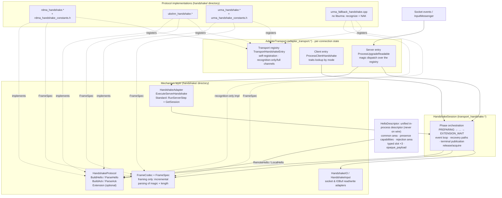
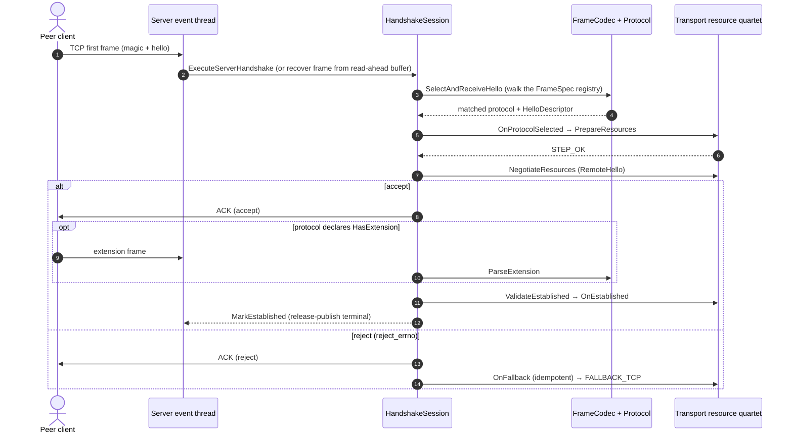

# Common Transport Handshake Design (RDMA / UBSHM / URMA)

This document describes a design, based on master, that converges the three
independent handshakes of RDMA, UBSHM and URMA into one common handshake
mechanism. Module and interface naming follows the reference implementation
on the `urma-handshake` branch (every interface signature and enum value in
this document has been checked against that branch's source); the handshake
information description mechanism borrows from Mooncake transfer-engine's
`HandShakeDesc` pattern.

- [Background and Current State](#background-and-current-state)
- [Goals and Non-Goals](#goals-and-non-goals)
- [Design Principles: What Mooncake Can and Cannot Teach Us](#design-principles-what-mooncake-can-and-cannot-teach-us)
- [Overall Architecture](#overall-architecture)
- [Handshake Information Description: HelloDescriptor](#handshake-information-description-hellodescriptor)
- [Frame Layer and Wire Formats](#frame-layer-and-wire-formats)
- [Session State Machine](#session-state-machine)
- [Threading Model and Memory Ordering](#threading-model-and-memory-ordering)
- [Compatibility Design](#compatibility-design)
- [Correctness Constraints](#correctness-constraints)
- [Redundancy Elimination](#redundancy-elimination)
- [Extensibility and Maintainability Design](#extensibility-and-maintainability-design)
- [Phased Rollout Plan](#phased-rollout-plan)
- [Testing Strategy](#testing-strategy)
- [Risks and Trade-offs](#risks-and-trade-offs)

## Background and Current State

On master, each of the three transports implements its own private
"upgrade an established TCP connection to a high-speed transport in place"
handshake, sharing no code:

| Transport | Handshake code location (master) | Size |
|---|---|---|
| RDMA | `src/brpc/rdma/rdma_handshake.{h,cpp}` + `rdma_handshake_server.{h,cpp}` + `rdma_handshake.proto` + `rdma_handshake_constants.h` + `policy/rdma_handshake_protocol.{h,cpp}` | ~1230 lines of dedicated files, plus ~41 handshake call sites scattered in `rdma_endpoint.cpp` |
| UBSHM | inlined in `src/brpc/ubshm/ub_endpoint.cpp` (36 handshake-related sites) | endpoint is ~1060 lines, roughly half of it handshake |
| URMA | `src/brpc/urma/urma_handshake.{h,cpp}` (~540 lines) + state machine inlined in `urma_endpoint.cpp` (42 handshake-related sites) | endpoint is ~1850 lines |

The three implementations repeat the same set of patterns, with drift:

1. **Magic-prefix dispatch**: the server peeks at the first bytes of the
   connection (`"RDMA"/"RDM3"`, `"UB"`, `"URMA"/"URM3"`); a match enters
   the upgrade flow, otherwise the connection falls back to TCP.
2. **Hello/ack exchange**: the client sends a hello, the server replies
   ACK/NAK; RDMA and URMA both have v2 (binary fixed-length) and v3
   (protobuf) wire versions.
3. **State machine**: hello → ack → (optional) extension → established /
   fallback; three isomorphic state machines, each implemented separately.
4. **TCP fallback**: on any failure the connection must degrade to a
   normal TCP connection and keep serving; it must not be closed.
5. **Recovery of handshake bytes consumed by `InputMessenger`**: the
   server-side protocol parser (`ParseHandshakeMessage`) must retrieve
   handshake bytes from the socket's read-ahead buffer.

The cost of duplication is already visible: the same class of bug needs
three fixes (e.g. residual handshake bytes corrupting the first message
parse was fixed separately for RDMA/URMA/UBSHM); adding a new transport
means copying the whole scaffold (~800 lines); behavioral details drift
between implementations (ACK validation strictness, errno choices, log
style).

## Goals and Non-Goals

Goals:

1. **Shared session orchestration**: the upgrade state machine, event
   driving, recovery paths and terminal-state publication are implemented
   once (`HandshakeSession`).
2. **Shared frame codec**: incremental parsing of magic/length fields,
   length validation and IOBuf assembly are implemented once
   (`FrameCodec`); protocols only declare frame specs (`FrameSpec`).
3. **Unified handshake information description**: the handshake payload
   of all three protocols is expressed in-process by a single descriptor
   (`HelloDescriptor`, borrowing from Mooncake `HandShakeDesc`); the
   transport layer consumes exactly one data structure.
4. **Table-driven participants**: each transport only provides four
   resource operations (prepare / apply peer hello / activate /
   deactivate) plus constant tables; the cost of a new transport drops
   to ~300 lines.
5. **Preserve TCP fallback semantics**: on any failure the connection
   degrades to TCP in place.

Non-goals (explicitly out of scope):

- **No wire-format unification**. RDMA v2/v3, UBSHM v3 and URMA v2/v3
  wire formats stay byte-for-byte unchanged; this design unifies
  in-process data structures and flow, not packets.
- **No out-of-band handshake channel** (Mooncake's dedicated TCP JSON-RPC
  model does not apply; see next section).
- **No change to external contracts**: the registration name
  `transport_handshake`, gflags names, bvar naming and interop with old
  peers are all preserved.

## Design Principles: What Mooncake Can and Cannot Teach Us

Mooncake transfer-engine's handshake mechanism (`mooncake-transfer-engine`):

- **Out-of-band channel**: `SocketHandShakePlugin` runs length-prefixed
  JSON RPC over a dedicated TCP connection, fully separate from the data
  plane;
- **Single descriptor**: `HandShakeDesc`
  (`include/transfer_metadata.h:197`) is a 33-line superset struct with
  common fields, `#ifdef`-gated transport fields and one opaque
  `payload`;
- **Presence as capability**: optional fields like `ready_ack` negotiate
  capability by whether the field is present;
- **Structured rejection**: a non-empty `reply_msg` means rejection, and
  rejection is always returned as an in-band structured reply rather
  than a transport-level error;
- **Minimal per-transport cost**: each transport only fills its slice of
  the desc, provides a passive callback and applies the peer desc
  (UB ~50 lines, URMA ~330, EFA ~250).

**What we adopt (absorbed into this design)**:

1. A single superset descriptor as the sole currency between codec and
   transport → `HelloDescriptor`;
2. Presence as capability → optional fields + `has_xxx` markers;
3. Structured rejection → `reject_errno`/`reject_msg`;
4. Per-transport work reduced to "fill descriptor / apply descriptor /
   four resource operations".

**What does not port (fundamental differences, not done)**:

1. **The out-of-band channel does not port.** brpc must upgrade in-band
   on the same TCP connection: the connection identity (fd, 4-tuple,
   already-buffered read-ahead data) must be preserved, and TCP fallback
   must happen on the original connection. This forces magic dispatch,
   incremental parsing and terminal-state publication — complexity
   Mooncake does not have. It is essential, not redundancy.
2. **A single JSON message does not port.** brpc must interoperate with
   already-deployed peers' binary formats; unification can only happen
   at the in-process descriptor layer.
3. **Reject-on-failure does not port.** Mooncake resets the connection
   on handshake failure; brpc's TCP fallback is a promised feature.

## Overall Architecture

Component layering (top to bottom is the call direction; solid edges =
calls/consumption, dotted edges = implementation/registration):



Sequence of a normal server-side upgrade (the client `RunClient` is its
mirror: `SendHello` → `ReceiveAck` → optional extension → `OnEstablished`
→ `MarkEstablished`):



Module/file naming follows the `urma-handshake` branch:

| File | Responsibility |
|---|---|
| `src/brpc/transport_handshake.h/.cpp` | `HandshakeSession`/`HandshakeProtocol`/`HandshakeTransport`: state machine, event loop, recovery paths, terminal-state publication |
| `src/brpc/handshake/handshake_frame.h/.cpp` | `FrameSpec`/`FrameCodec`/`FrameResult`: incremental frame parsing |
| `src/brpc/handshake/handshake_io.h/.cpp` | `HandshakeIO`/`HandshakeInput`: read/write adapters over socket and IOBuf |
| `src/brpc/handshake/handshake_adapter.h/.cpp` | `HandshakeAdapter`: the minimal seam between an upgrade protocol and `InputMessenger` |
| `src/brpc/adapter_transport.h/.cpp` | per-connection state, generic client/server participants, magic dispatch |
| `src/brpc/policy/transport_handshake_protocol.h/.cpp` | server-side protocol shell; registered in `global.cpp` as `CONNECTION_TYPE_ALL` under the name `transport_handshake` |
| `src/brpc/handshake/{rdma,ubshm,urma}_handshake.*` | per-protocol codecs, constants, protocol objects |
| `src/brpc/handshake/urma_fallback_handshake.cpp` | URMA hello recognition and NAK codec without liburma |

Key interfaces (checked one by one against the `urma-handshake` branch
source). All mappings between `AdapterTransport` and the individual
transports collapse into a single **transport registry** (self-registering,
zero edits to common code) — see
[Extensibility and Maintainability Design](#extensibility-and-maintainability-design):

```cpp
// transport_handshake.h — per-protocol message codec. Implementations own
// the parsed protocol state and expose it via
// const ParsedHello& remote() const (see the HelloDescriptor section).
class HandshakeProtocol {
public:
    virtual int ProtocolVersion() const = 0;
    virtual StepResult BuildHello(bool enabled, std::string* payload) = 0;
    virtual StepResult ParseHello(const std::string& payload) = 0;
    // RDMA and UBSHM share the default four-byte, network-order ACK;
    // protocols with a different ACK format may override these.
    virtual StepResult BuildAck(bool enabled, std::string* payload);
    virtual StepResult ParseAck(const std::string& payload, bool* enabled);
    // Whether to ACK a hello whose peer did not enable this transport
    // (URMA legacy: false — fall back without an ACK).
    virtual bool AckDisabledHello() const { return true; }
    virtual bool HasExtension() const { return false; }  // optional ext frame
    virtual StepResult BuildExtension(bool, std::string*);
    virtual StepResult ParseExtension(const std::string&);
};

// transport_handshake.h — per-transport resource operations (the
// participant's delegation target)
class HandshakeTransport {
public:
    virtual void OnProtocolSelected(HandshakeProtocol*) {}  // re-invoke on recovery (C1)
    virtual StepResult PrepareResources() = 0;    // QP/jetty/shm pools
    virtual StepResult NegotiateResources() = 0;  // apply peer hello (reads protocol->remote())
    virtual void OnEstablished() = 0;             // activate data plane
    virtual void OnFallback() = 0;                // idempotent; release (C3)
    virtual void OnFailed() = 0;
    virtual StepResult ValidateEstablished() { return STEP_OK; }  // re-check after ACK (C2)
};
// Convenience bases FallbackHandshakeTransport / FallbackHandshakeProtocol
// are provided for "recognize the hello, then fall back" users.

// handshake_adapter.h — the minimal seam between an upgrade protocol and
// InputMessenger
class HandshakeAdapter {          // one per server Socket
public:
    virtual ParseResult ExecuteServerHandshake(butil::IOBuf* source,
                                               Socket* socket) = 0;
};
class StandardHandshakeAdapter : public HandshakeAdapter {
    // subclasses provide only RunServerStep(source, socket) and
    // GetSession(socket); the common session owns all phases.
};

// transport_handshake.h — phase orchestration, frame I/O and
// terminal-state publication
class HandshakeSession {
public:
    StepResult RunClient(HandshakeProtocol* protocol,
                         HandshakeTransport* transport);
    StepResult RunServer(const std::vector<HandshakeProtocol*>& protocols,
                         HandshakeInput* input,
                         HandshakeTransport* transport,
                         bool fallback_on_not_mine);
    int phase(butil::memory_order order) const;   // sole cross-thread entry
    void MarkEstablished();                       // release-publish terminal
    void MarkFailed();
    template <typename PublishTcpActive>
    void PublishFallback(PublishTcpActive publish_tcp_active);  // see below
    void SetIOForTest(HandshakeIO* io);           // inject in-memory stream
};
```

## Handshake Information Description: HelloDescriptor

This is the core mechanism adopted from Mooncake.

### Problem

In the reference implementation, each protocol object owns its parse result
and exposes it as `const ParsedHello& remote() const`, where `ParsedHello`
is a different type per protocol:

| Protocol | Parsed-hello type | Defined at |
|---|---|---|
| RDMA | `RdmaConnectionInfo` (block_size / sq_size / rq_size / lid / gid / qp_num / `optional<ibv_ece>`) | `rdma/rdma_endpoint.h:47` |
| URMA | `UrmaConnectionInfo` (buffer_size / recv_buffer_cnt / jetty_id / eid / uasid / tp_type / seg_*) | `urma/urma_endpoint.h:51` |
| UBSHM | `HelloMessage` (msg_len / hello_ver / impl_ver / len / shm_name) + `HelloFormatExtension` | `handshake/ubshm_handshake.h` |

Participants must therefore hold a **concrete-typed** protocol pointer to
apply the peer hello. The RDMA server participant, for example:

```cpp
// handshake/rdma_handshake.cpp, reference implementation
rdma::RdmaHandshakeAdapter* _protocol;               // concrete type
StepResult NegotiateResources() override {
    return _transport->NegotiateUpgradeResources(
               _protocol->remote(), true) == 0 ? STEP_OK : STEP_FALLBACK;
}
```

The three parsed-hello types do not interoperate ⇒ participants cannot be
truly generalized (one participant class per transport); capability
negotiation is ad-hoc per-protocol version comparison; rejection reasons
live only in logs, not in any structure.

### Design: a unified in-process descriptor

`HelloDescriptor` is a superset struct of every protocol's hello. It
**exists only in-process and never goes on the wire**. Each protocol's
`ParseHello` translates wire bytes into it; `HandshakeProtocol` unifies
the return type of `remote()` to it; each transport's
`NegotiateResources` consumes only it; `BuildHello` produces wire bytes
from it.

```cpp
// src/brpc/handshake/hello_descriptor.h
// Zero transport-library dependencies: the whole struct is POD + std::string
// and must not contain ibv_*/urma_* SDK types (see the descriptor
// discipline in "Extensibility and Maintainability Design").
struct HelloDescriptor {
    // ---- common area (required for all protocols) ----
    SocketMode mode;              // SOCKET_MODE_RDMA/UBSHM/URMA
    int wire_version = 0;         // wire version of the peer's hello
    bool peer_enabled = false;    // peer requests upgrade (false = probe only)

    // ---- capability area: presence as capability (borrowing from
    //      Mooncake ready_ack_supported) ----
    bool has_extension = false;   // peer declares an extension frame after ACK
    bool has_data_format = false; // peer declares format negotiation (UBSHM ext)
    bool has_ece = false;         // peer hello carries ECE (RDMA v3)

    // ---- rejection area (borrowing from Mooncake reply_msg) ----
    // filled when BuildAck(false); mapped onto existing NAK encodings
    // when the wire format is frozen
    int reject_errno = 0;         // 0 = accept
    std::string reject_msg;       // human-readable; only v3 (pb) carries it

    // ---- per-protocol typed slots (select by mode; fields correspond
    //      one-to-one to master's existing connection-info structs —
    //      migration moves fields, never semantics) ----
    struct RdmaInfo {             // = RdmaConnectionInfo
        uint32_t block_size; uint16_t sq_size; uint16_t rq_size;
        uint16_t lid; uint8_t gid[16]; uint32_t qp_num;
        uint64_t ece_raw;         // valid when has_ece; opaque storage whose
                                  // interpretation belongs to the RDMA
                                  // codec/endpoint
    } rdma;
    struct UbshmInfo {            // = HelloMessage + HelloFormatExtension
        uint16_t hello_ver, impl_ver;
        uint64_t len;
        char shm_name[SHM_MAX_NAME_BUFF_LEN];
        int32_t data_format;      // valid when has_data_format
    } ubshm;
    struct UrmaInfo {             // = UrmaConnectionInfo
        uint32_t buffer_size; uint32_t recv_buffer_cnt;
        uint32_t jetty_id; uint8_t eid[16]; uint32_t uasid;
        uint8_t tp_type;
        uint8_t seg_eid[16]; uint32_t seg_uasid;
        uint64_t seg_va; uint64_t seg_len; uint32_t seg_token_id;
    } urma;

    // ---- opaque extension (borrowing from Mooncake payload) ----
    // not interpreted by codecs; private to the two endpoints; empty by default
    std::string opaque_payload;
};

// The unified accessor on HandshakeProtocol (replaces the per-protocol
// ParsedHello typedefs):
class HandshakeProtocol {
    virtual const HelloDescriptor& RemoteHello() const = 0;
    virtual const HelloDescriptor& LocalHello() const = 0;
};
```

Mapping from Mooncake `HandShakeDesc`:

| Mooncake | HelloDescriptor | Notes |
|---|---|---|
| `local_nic_path`/`peer_nic_path`/`local_gid`/`local_lid`/`qp_num` | `rdma` typed slot | RDMA-only fields find their home |
| `jetty_num` (UB/URMA) | `urma.jetty_id` etc. | URMA-only fields find their home |
| `ready_ack`/`ready_ack_supported` | `has_extension`/`has_data_format`/`has_ece` etc. | presence as capability: omitted when encoding, set by field presence when decoding |
| `reply_msg` | `reject_errno` + `reject_msg` | structured rejection; legacy wire keeps the errno-to-NAK mapping |
| `payload` (used by NCCL to tunnel private JSON) | `opaque_payload` | not interpreted by codecs |
| `#ifdef USE_UB/USE_EFA/...` fields | runtime typed slots | brpc compiles all three protocols in-tree; no compile-time gating needed |

### Why the wire cannot be unified but the descriptor can

Wire formats are frozen by deployed versions (five binary/protobuf
formats across RDMA v2/v3, UBSHM v3, URMA v2/v3); any change breaks
rolling upgrades. `HelloDescriptor` is in-process: as long as codecs
translate correctly in both directions, the struct itself is free to
evolve (new fields, new capability bits) without affecting interop.
Mooncake enjoys the single-descriptor dividend because both its ends
ship the same version; brpc obtains the same dividend under
mixed-version constraints via the codec translation layer.

### Benefits

- `NegotiateResources()` no longer depends on concrete-typed protocol
  pointers: a generic participant simply calls
  `protocol->RemoteHello()` to obtain a `HelloDescriptor`, and the
  dedicated RDMA/URMA participant classes disappear entirely (see
  [Redundancy Elimination](#redundancy-elimination));
- capability negotiation becomes uniform presence checks instead of
  ad-hoc version comparisons;
- rejection reasons travel structurally: v3 (pb) wire can carry
  `reject_msg`; v2 wire falls back to the existing NAK encoding (errno
  semantics unchanged), while local logs can still print the local
  `HelloDescriptor::reject_msg`.

## Frame Layer and Wire Formats

Per-protocol wire formats **remain as on master** (byte-for-byte frozen):

| Protocol | Magic | Hello header | Version | ACK |
|---|---|---|---|---|
| RDMA v2 | `"RDMA"` | u16 total_len(40..4096) + u16 hello_ver(2) + u16 impl_ver(1) + body (block_size/sq_size/rq_size/lid/gid/qp_num) | 2 | 4B BE flags, bit0=RDMA_OK |
| RDMA v3 | `"RDM3"` | u32 pb_len(≤8192) + protobuf body (may carry ECE) | 3 | same |
| UBSHM v3 | `"UB"` | u16 msg_len(=64) + u16 hello_ver(3) + u16 impl_ver(1) + len + shm_name(48B) | 3 | 4B format extension (when negotiating data_format) + 4B ACK |
| URMA v2 | `"URMA"` | u16 total_len(86..4096) + u16 hello_ver(2) + u16 impl_ver(1) + 82B body | 2 | 4B BE flags, bit0=URMA_OK |
| URMA v3 | `"URM3"` | u32 pb_len(≤4096) + protobuf body | 3 | same |

The frame layer only abstracts the framing of "magic + length field" and
never touches business fields:

```cpp
// handshake_frame.h
struct FrameSpec {
    enum LengthEncoding { FIXED,            // fixed-length frame (UBSHM hello)
                          U16_TOTAL_LENGTH,  // u16 total incl. magic (RDMA/URMA v2)
                          U32_BODY_LENGTH }; // u32 body length (v3 pb)
    const char* magic;
    size_t magic_len;
    size_t min_frame_len;                  // lower bound incl. magic
    size_t max_frame_len;                  // upper bound
    LengthEncoding length_encoding;
};

enum FrameResult { FRAME_OK, FRAME_NOT_MINE, FRAME_NEED_MORE,
                   FRAME_IO_ERROR, FRAME_PROTOCOL_ERROR };

// Framing only: protocols receive and produce the payload after the
// magic/length fields and remain responsible for their own business
// fields and version semantics.
class FrameCodec {
public:
    static FrameResult Encode(const FrameSpec&, const std::string& payload,
                              std::string* frame);
    static FrameResult ReadFrame(HandshakeIO*, const FrameSpec&,
                                 bool push_back_on_not_mine,
                                 std::string* payload);
    static FrameResult ParseBufferedFrame(HandshakeInput*, const FrameSpec&,
                                          std::string* payload,
                                          bool* magic_matched = nullptr);
    static FrameResult WriteFrame(HandshakeIO*, const FrameSpec&,
                                  const std::string& payload);
};
```

Magic strings are **defined exactly once**: each handshake module exports
its `FrameSpec` table as the `recognize_specs` field of its transport
registry entry (see
[the extensibility section](#transport-registry-the-single-central-edit-site));
the server-side dispatch in `AdapterTransport` walks the registry instead
of hard-coding the five `"UB"/"RDMA"/...` magics. A new transport
registers one line and touches no shared code.

## Session State Machine

The phase enum (**numeric ordering is a contract**, see constraint C7):

```
UNINITIALIZED=0 → PREPARING=1 → HELLO_SEND=2 → HELLO_WAIT=3
              → NEGOTIATING=4 → ACK_SEND=5 → ACK_WAIT=6
              → EXTENSION_SEND=7 → EXTENSION_WAIT=8
              → ESTABLISHED=0x100 | FALLBACK_TCP=0x200 | FAILED=0x300
```

Step results: `STEP_OK / STEP_FALLBACK / STEP_NEED_MORE / STEP_NOT_MINE /
STEP_ERROR`.

- **Client** (`RunClient`): synchronous driver running inside a bthread;
  `SendHello` → `ReceiveAck` (with deadline) → optional extension →
  `OnEstablished` → `MarkEstablished`.
- **Server** (`RunServer`): event-driven; `SelectAndReceiveHello` (tries
  each registered `FrameSpec` magic, invokes `OnProtocolSelected` once
  selected) → `PrepareResources` → `NegotiateResources` → `SendAck` →
  optional extension → `ValidateEstablished` → `MarkEstablished`; any
  step returning `STEP_NOT_MINE`/`STEP_FALLBACK` enters `PublishFallback`
  when `fallback_on_not_mine` allows.
- **Recovery paths**: a server socket's handshake bytes may already have
  been consumed by `InputMessenger` into the read-ahead buffer;
  `ParseBufferedFrame` first recovers frames from the buffer, then the
  protocol is re-selected from the saved `phase + protocol_version` and
  **`OnProtocolSelected` is re-invoked** (constraint C1).
- **Terminal-state publication**: `ESTABLISHED/FALLBACK_TCP/FAILED` are
  release-published by the writing thread and acquire-subscribed by
  readers; concurrent observers such as `Socket::CheckHealth` access the
  phase exclusively through `phase(order)` — no data race.

## Threading Model and Memory Ordering

- All phase transitions happen on the thread holding socket semantics;
  cross-thread observers only read `_phase` (release/acquire, solely via
  `phase(order)`).
- `PublishFallback` is a template method that first runs the caller's
  TCP-active state publication and then release-stores `FALLBACK_TCP` —
  this is the common form of the two ordering fixes from #3347 and
  #3406: the release store makes the TCP-active state and any
  pushed-back bytes visible to the event thread that observes
  `FALLBACK_TCP`.
- `_protocol_version` is read cross-thread on diagnostic/logging paths
  and is a plain `int` in the reference implementation; when landing
  this design it **must become atomic** (constraint C4).
- Server event callbacks are re-entrant (multiple events for the same
  socket); event handlers are idempotent: duplicate events at the same
  phase do not double-advance.
- `OnFallback` may be invoked once by the ACK-NAK path and once by the
  error path; it **must be idempotent** (constraint C3): release
  resources by swap-then-release, never bare null-out.

## Compatibility Design

| Combination | Behavior |
|---|---|
| new client ↔ new server | negotiate the highest common version (RDMA/URMA prefer v3, gflag-controlled) |
| new client (v3) ↔ old server (v2-only) | old server either walks the v2 flow on `"RDMA"` magic or fails to recognize `"RDM3"` and falls back to TCP; client falls back to TCP per existing v3 failure semantics (same as master) |
| old client (v2) ↔ new server | server registers both v2/v3 magics in the `FrameSpec` table and processes v2 |
| new code built without RDMA/URMA | dependency-free codecs like `urma_fallback_handshake` still recognize hellos and NAK correctly into TCP fallback |
| TCP-only peer | magic mismatch (`FRAME_NOT_MINE`/`STEP_NOT_MINE`) → fallback; first-packet bytes are handed back to brpc protocol parsing untouched |
| peer sends a "not enabled" hello | whether to ACK is decided by `AckDisabledHello()` (URMA legacy does not ACK and falls back directly) |
| any resource-preparation failure | `OnFallback` (idempotent) → FALLBACK_TCP; the connection stays open |

Frozen external contracts: the registration name `transport_handshake`
(registered in `global.cpp` as `CONNECTION_TYPE_ALL`), existing gflags
(`rdma_handshake_version` etc.), bvar names (connection-level bvar merge
rules), and legacy URMA's ACK-less direct fallback
(`AckDisabledHello()=false`).

## Correctness Constraints

The following constraints come from review findings on the
`urma-handshake` reference implementation. They are **mandatory
contracts** of this design; each must be satisfied with a test when
implemented:

- **C1 Re-select protocol on recovery paths**: after re-finding the
  protocol by version, the ACK_WAIT/EXTENSION_WAIT recovery branches of
  `RunServer` must re-invoke `OnProtocolSelected`, otherwise the
  participant gets a dangling protocol pointer.
- **C2 Resource validation at ACK stage**: `ValidateEstablished`
  re-checks after the ACK arrives (the reference implementation checks
  `source->empty()` so a business first packet glued to the ACK is not
  swallowed; it must also re-check that resources are still usable).
- **C3 `OnFallback` is idempotent**: may be called multiple times;
  implementations use swap-then-release (the reference implementation's
  `DeactivateUpgrade` on all three transports already satisfies this;
  migration must preserve it).
- **C4 `protocol_version` is atomic**: a plain `int` read cross-thread
  in the reference implementation; becomes an atomic with the same
  release/acquire discipline as `_phase`.
- **C5 Failure observability**: best-effort transports such as URMA must
  log when degrading on resource exhaustion (missing logs make
  production degradation silent).
- **C6 Single source of constants**: wire constants (magic, length
  bounds, version numbers) live in one `*_handshake_constants.h` per
  protocol, shared by the real codec and the fallback codec; duplicated
  literals are forbidden.
- **C7 Phase values are ordered**: event handlers rely on `<`
  comparisons; the Phase enum must not be reordered; terminal states
  live in a separate range starting at 0x100.
- **C8 RDMA CQ lifetime**: CQ callbacks may hold objects already freed
  by `CleanupRdmaResources`; a generation/reference-counting mechanism
  homologous to URMA's `CqLifetime` is required (Mooncake uses
  `qp_generation` to invalidate stale handshake replies — same idea).

## Redundancy Elimination

Compared to "moving the three master implementations into one
directory", this design cuts at three additional layers:

1. **Table-driven participants.** With `HelloDescriptor` and the unified
   `RemoteHello()/LocalHello()` accessors, participants no longer hold
   concrete-typed protocol pointers: define generic
   `ServerHandshakeTransport`/`ClientHandshakeTransport` delegating to
   each transport's `PrepareUpgradeResources`/
   `NegotiateUpgradeResources`/`ActivateUpgrade`/`DeactivateUpgrade`
   quartet. The RDMA and URMA dedicated participants disappear entirely,
   while UBSHM keeps a ~15-line thin subclass for its shm parameter and
   `SetNegotiatedDataFormat`. The three mode blocks in the client-side
   `ProcessClientHandshake` collapse into one traits template function
   (availability check → fallback, build protocol, RunClient,
   StartUpgradeEvents error handling, CompleteConnection are written
   once), carried by the `client` entry of the transport registry.
2. **Parameterized fallback protocols.** The three `FallbackProtocol`s
   differ only in version, `FrameSpec`, disabled-hello constructor and
   `AckDisabledHello()`; they collapse into one parameterized class plus
   one static table per protocol (the registry's recognition-only entry).
   This also forces behavioral alignment, eliminating drift like "URMA v3
   validates pb while RDMA does not".
3. **Mechanism sinking and dead-code cleanup**: the v2 `msg_len`
   strip/rebuild trick moves into FrameCodec helpers; mechanisms with no
   production call sites such as `TryReadOnTcp` are deleted or marked
   test-only; URMA constants get their own header (constraint C6), and
   the duplicated literals in the fallback codec are removed.

After the cuts, adding a transport costs one codec
(BuildHello/ParseHello/BuildAck/ParseAck, ~200 lines) + one constant
table + one resource-operation quartet + one magic registration line —
about 300 lines, with no state-machine code at all.

## Extensibility and Maintainability Design

The long-term value of this mechanism depends on the cost of adding the
4th and 5th transports and on the cost of evolving existing ones. This
section collapses every "central edit site" into a single registry and
lays out the evolution discipline for the wire format, capabilities and
the descriptor.

### Transport registry: the single central edit site

In the reference implementation, adding a transport requires touching 6
sites of common code: a new enum value in `socket_mode.h` (a global
header that triggers a full rebuild), the transport-creation switch in
`AdapterTransport`'s constructor, the `upgrade_capable` switch, the mode
block in the client-side `ProcessClientHandshake`, the hard-coded magic
matching in the server-side `ProcessUpgradeReadable`
(`matches_ub/matches_rdma/matches_urma`), and a new transport header
include in common files. Missing any one of them compiles fine but
silently falls back at runtime — and the three duplicated switches are
exactly what the previous redundancy review flagged.

The design instead lets each transport self-register one entry from its
own translation unit; common code needs zero edits:

```cpp
// adapter_transport.h — one entry per transport, self-registered during
// static initialization
struct TransportHandshakeEntry {
    SocketMode mode;                    // unique within the table
    const char* name;                   // "rdma"/"ubshm"/"urma"; used by bvar/logs
    // ---- full registration (linked only when BRPC_WITH_xxx is on) ----
    std::unique_ptr<Transport> (*create_transport)();
    bool (*upgrade_ready)(const Transport*);
    ClientHandshakeTraits client;       // availability check/build protocols/
                                        // post-establish actions
    std::vector<std::unique_ptr<HandshakeAdapter>> (*create_server_adapters)(
        Transport*);
    // ---- recognition-only registration (always compiled, even without
    //      the transport library) ----
    const handshake::FrameSpec* recognize_specs;   // magic + length bounds
    std::unique_ptr<HandshakeProtocol> (*create_recognizer)();  // NAK-only
};
// one line at the bottom of each transport's .cpp, e.g.
// handshake/ubshm_handshake.cpp:
static const AdapterTransport::Registration reg =
    AdapterTransport::Register({SOCKET_MODE_UBRING, "ubshm", ...});
```

The two registration kinds generalize the `urma_fallback_handshake`
pattern:

- **Recognition-only registration**: always compiled. On a magic match
  it parses the hello and replies NAK so the peer falls back to TCP
  cleanly — a brpc node without the transport library still interoperates
  with cluster nodes that have it enabled. This is the pattern URMA
  already validated and RDMA should adopt too.
- **Full registration**: linked only when `BRPC_WITH_xxx` is on, and
  provides the resource-operation quartet and server adapters; when not
  linked, upgrade requests for that mode naturally take the
  recognition-only NAK path.

Server-side dispatch = walking `recognize_specs` of every registered
entry; the client = looking up traits by `mode`. The `SocketMode` enum
stays (bvar naming and connection state graphs depend on it), but the
mode → transport mapping exists only in the registry; adding an enum
value is part of declaring a registry entry, not of scattering switches.

### Wire-version evolution policy

- The five existing formats are frozen: changing a format means a new
  magic plus an **additive registration** of a new `FrameSpec`/protocol
  object — never editing an existing entry or changing any existing
  behavior other than match-preference order.
- Version negotiation = the client picks its wire version via gflags;
  the server tries magic matches in the preference order recorded in the
  registry entry (v3 preferred, v2 fallback) — same semantics as today.
- Don't touch the wire when you don't have to: prefer carrying new
  negotiation content in an extension frame (below).

### Capability evolution policy

Three channels, in increasing order of intrusion:

1. **Append an optional field + `has_xxx` to HelloDescriptor**: v3 (pb)
   gains proto3 forward compatibility for free — unknown fields are
   ignored and an old codec that doesn't decode a new field simply
   treats the capability as unsupported. Frozen v2 fields cannot be
   appended — if a capability must live in the hello body itself, use
   channel 3.
2. **Extension frames** (`HasExtension`/`BuildExtension`/
   `ParseExtension`): the post-ACK renegotiation channel. UBSHM's
   `data_format` already validated this pattern: upgrading the handshake
   mechanism itself (format negotiation) needs no wire-level change. All
   new "negotiate-after-handshake" capabilities must go here.
3. **New wire version**: only when the hello body must carry new
   semantics; registered additively per the wire-version policy.

Rejection semantics layer the same way: v3 can carry `reject_msg`; v2
falls back to the existing NAK encoding (errno semantics unchanged) and
`reject_msg` goes to the local log only.

### Descriptor discipline

`hello_descriptor.h` is included by every transport codec and must have
**zero transport-library dependencies**: POD and `std::string` only, no
`ibv_*`/`urma_*` SDK types inside the typed slots (e.g. RDMA's ECE is
stored as the opaque `uint64_t ece_raw`, whose interpretation belongs to
the RDMA codec and endpoint). Evolution rules:

- new slots are **appended only**; existing field semantics must not
  change and cross-slot references are forbidden;
- the common area holds only genuinely cross-protocol concepts; each
  protocol's private concepts live in its own slot;
- private experiments and not-yet-settled capabilities go through
  `opaque_payload`, never the common area.

### Conformance self-test (framework baseline)

The test directory provides a self-registering loopback/null transport
that runs both ends over the `SetIOForTest` in-memory stream, serving as
the framework's conformance baseline: any change to the framework itself
must pass the baseline first, then the three real transports. The exit
gate for adding a transport = the shared conformance matrix (frame
layer / state machine / recovery paths / fallback / old-new
combinations) all green — not merely "its own tests pass", which is how
framework rot goes unnoticed when every transport tests only itself.

### Checklist for adding a transport

1. `handshake/<proto>_handshake.{h,cpp}`: the codec
   (Build/ParseHello, Build/ParseAck, optional extension) + protocol
   object;
2. `<proto>_handshake_constants.h`: wire constants (constraint C6);
3. append a typed slot + `has_xxx` to `HelloDescriptor` (the only
   shared-header edit this mechanism allows);
4. implement the resource-operation quartet on the transport side
   (`PrepareUpgradeResources`/`NegotiateUpgradeResources`/
   `ActivateUpgrade`/`DeactivateUpgrade`);
5. self-register a `TransportHandshakeEntry` (one recognition-only line
   + one full line);
6. if the transport library may be absent: put the recognition-only
   codec in its own file, following `urma_fallback_handshake.cpp`;
7. conformance-matrix cases + an end-to-end example (echo over
   <proto>);
8. update this document.

### Explicitly not done (against over-design)

- the registry is a compile-time static table; no dynamic
  loading/dlopen/plugin ABI;
- the descriptor stays a plain struct; no protobuf/Any/reflection;
- no protocol branches are added to the `HandshakeSession`/`FrameCodec`
  core paths;
- cross-transport constant sharing is forbidden (each protocol's magic
  and length bounds must not reference another's).

## Phased Rollout Plan

Based on master; each phase merges independently with compatible
behavior:

- **P0 common skeleton**: land `transport_handshake.*`,
  `handshake_frame.*`, `handshake_io.*`, `handshake_adapter.*`,
  `hello_descriptor.h`, `policy/transport_handshake_protocol.*`
  (registration name unchanged, `CONNECTION_TYPE_ALL`) and the
  **transport registry** (with recognition-only/full dual channels). No
  transport attached; pure addition + unit tests (including the
  loopback conformance-baseline transport).
- **P1 RDMA migration**: RDMA adopts the skeleton
  (`handshake/rdma_handshake.*` + reuse master's
  `rdma_handshake_constants.h`); delete the private implementations in
  `rdma_handshake_server.*` and `policy/rdma_handshake_protocol.*`;
  address C8 (CQ generation) and C4. Verify: v2/v3 old/new interop,
  read-ahead recovery, fallback.
- **P2 UBSHM migration**: `handshake/ubshm_handshake.*`; the inlined
  state machine in the endpoint is deleted, leaving only the
  resource-operation quartet in `ub_endpoint.cpp`. Verify: shm
  negotiation, data_format extension, fallback.
- **P3 URMA migration**: `handshake/urma_handshake.*` +
  `urma_handshake_constants.h` (C6) + `urma_fallback_handshake.cpp`
  (recognition without liburma). Verify: v2/v3, legacy ACK-less
  fallback, `AckDisabledHello`, mock_urma unit tests.
- **P4 wrap-up**: all hard-coded dispatch and mode switches move onto the
  registry (including consolidating the `SocketMode` mapping into the
  single registry site); dead-code cleanup; documentation updates.

Regression floor for every phase: `transport_handshake` unit tests all
green, `urma_fallback` unit tests all green, and the corresponding
transport's end-to-end example (echo over RDMA/UBSHM/URMA) interoperates.

## Testing Strategy

- **Frame layer**: `FrameCodec` against all three `LengthEncoding`s with
  whole-frame / fragmented / coalesced / oversized / truncated cases
  (including continuation across events).
- **State machine**: normal upgrade, NAK fallback, invalid-hello
  fallback, ACK timeout, missing/extra extension, recovery paths
  (fabricate buffered data to start at ACK_WAIT/EXTENSION_WAIT and
  verify C1), duplicate-event idempotence.
- **Compatibility matrix**: old/new client × old/new server × v2/v3 ×
  with/without transport libraries compiled; use fallback codecs to
  simulate the peer.
- **Concurrency**: `CheckHealth` racing handshake completion (terminal
  visibility), simultaneous handshakes on both ends, stale event
  snapshots.
- **URMA mock**: keep using `mock_urma` (main unit tests run without
  liburma; note macOS lacks `sys/eventfd.h`, so a Linux environment is
  required).

## Risks and Trade-offs

- **Superset descriptor bloat**: `HelloDescriptor` grows as protocols
  are added. Mitigation: typed slots are selected by `mode`, cross-slot
  references are forbidden; `opaque_payload` carries private extensions;
  common fields hold only genuinely cross-protocol concepts.
- **Unification must not become over-unification**: each protocol's
  `ParseHello` field semantics (UBSHM format extension, URMA `tp_type`
  narrowing checks, RDMA ECE) stay inside the per-protocol codec and are
  not templated together — the differences are real protocol semantics,
  not accidental duplication.
- **Regression risk while freezing behavior**: each of P1–P3 changes the
  code path of an existing transport. Mitigation: independent merge per
  phase + compatibility-matrix tests + gflag-controlled version
  selection, so a single phase can be rolled back on trouble.
